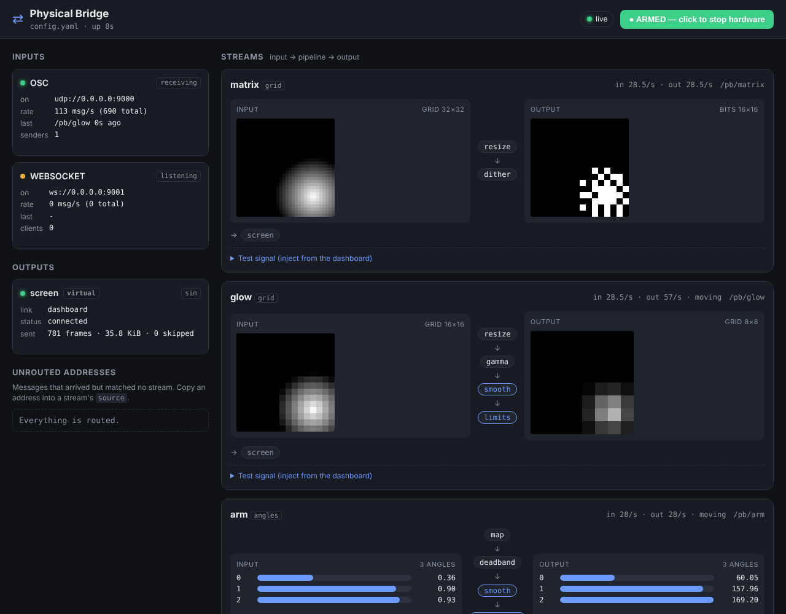

# Physical Bridge

A small local tool that takes data from creative software — **TouchDesigner,
Unreal Engine, Blender**, or anything that speaks **OSC, WebSocket or MIDI** —
processes it, and sends it to **hardware**: servos, steppers and LED matrices on
Arduino or ESP32, over USB serial, RS485 or Wi-Fi.

* **4 data types**: 2D bit grids, 2D value grids (0–255), lists of motor angles, single values
* **Processing**: resize, threshold, dithering, smoothing, easing, rate limiting, value mapping, deadband,
  gamma, flip/rotate and **safety limits** (min/max, max speed, LED power budget)
* **Output plugins**: serial (Arduino/ESP32), RS485 bus, OSC forwarding, and a **virtual device** in the dashboard
* **Web dashboard**: live input, processed output, connection status, test signals, an ARM/DISARM switch
* **One YAML file** for configuration
* **Firmware**: Arduino + ESP32 sketches for servos, steppers and LED matrices, sharing one tiny protocol



---

## Contents

1. [Architecture](#architecture)
2. [Quick start (no hardware)](#quick-start-no-hardware)
3. [Connect your first device](#connect-your-first-device)
4. [Sending from TouchDesigner, Unreal, Blender](#sending-from-your-software)
5. [Configuration reference](#configuration-reference)
6. [Processing steps](#processing-steps)
7. [Outputs](#outputs)
8. [Protocol](#protocol)
9. [Safety](#safety)
10. [Writing an output plugin](#writing-an-output-plugin)
11. [Project layout & tests](#project-layout--tests)

---

## Architecture

```
  TouchDesigner    Unreal (OSC plugin)    Blender script    Browser / Node    MIDI controller
        │                   │                    │                 │                 │
        └───────────────────┼────────────────────┘
                            │ OSC  udp :9000                       │ WS :9001        │ MIDI
┌───────────────────────────▼──────────────────────────────────────▼─────────────────▼───┐
│ INPUTS        every message becomes (address, payload)                                 │
│               /pb/arm  ·  {"stream": "arm"}  ·  /midi/cc/1/7                           │
└───────────────────────────────────────────┬────────────────────────────────────────────┘
                                            │ route by source: exact address, glob or list
┌───────────────────────────────────────────▼────────────────────────────────────────────┐
│ STREAMS       one per thing you control, all defined in config.yaml                    │
│                                                                                        │
│  "matrix"  grid    coerce ─► resize ─► gamma ─► dither ──────────────► bits 16×16      │
│  "arm"     angles  coerce ─► map ─► smooth ─► rate_limit ─► SAFETY ──► angles [3]      │
│  "dimmer"  value   coerce ─► ease ─► map ────────────────────────────► value           │
│  SAFETY = min · max · max_speed · max_mean, always the last step                       │
│  static steps run once per input; smooth / ease / limits keep ticking at tick_hz       │
└───────────────────────────────────────────┬────────────────────────────────────────────┘
                                            │ newest frame per stream (stale ones skipped)
┌─────────────────────┬─────────────────────┼──────────────────────┬─────────────────────┐
│ serial              │ rs485               │ osc                  │ virtual             │
│ USB or socket://    │ addressed bus       │ forward over UDP     │ shown in dashboard  │
└──────────┬──────────┴──────────┬──────────┴───────────┬──────────┴──────────┬──────────┘
           │ PBP frames          │ PBP frames           │ OSC                 │
           ▼                     ▼                      ▼                     ▼
    Arduino / ESP32      node 1 · node 2 · …     other software     ┌──────────────────────┐
    servos, steppers     (MAX485 on each)        lighting desks     │ DASHBOARD :8080      │
    LED matrices                                                    │ live input & output  │
                                                                    │ status · test · ARM  │
                                                                    └──────────────────────┘
```

How data moves:

1. **Inputs** turn every incoming message into `(address, payload)`. OSC uses its
   address (`/pb/arm`), WebSocket messages name a `stream` or `address`, MIDI
   becomes `/midi/cc/<ch>/<cc>`, `/midi/note/<ch>/<note>`, `/midi/pitchbend/<ch>`.
2. A **stream** whose `source` matches picks the message up and **coerces** it to
   its type (`bits`, `grid`, `angles`, `value`) — nested lists, flat lists with a
   `[w, h, …]` header, OSC blobs and JSON objects are all understood.
3. The stream's **pipeline** runs. Static steps (resize, dither, map…) run once per
   input; dynamic steps (smooth, ease, speed limits) keep running at `tick_hz`
   until they settle, so motion continues smoothly between input frames.
4. Stream-level **safety** limits always run last.
5. The result goes to each listed **output**. Outputs keep only the newest frame
   per stream, so a slow serial line never builds up lag.
6. The **dashboard** shows every stage at ~15 Hz and can inject test data.

Code map: `inputs/` → `stream.py` (+ `processing/`) → `outputs/`, wired by
`bridge.py`, configured by `config.py`, shown by `dashboard/`.

---

## Quick start (no hardware)

Requires Python 3.9+.

```bash
git clone https://github.com/devsaraf20/physical-bridge.git
```

```bash
cd physical-bridge
```

```bash
pip install -e .            # add [midi] for MIDI input: pip install -e ".[midi]"
```

```bash
physical-bridge -c config.yaml
```

Open **<http://localhost:8080>**. The default `config.yaml` sends four streams to
virtual devices. Feed it some animated data without any creative software:

```bash
python examples/python/send_test.py          # OSC; add --ws to use WebSocket
```

You can also expand **Test signal** under any stream in the dashboard to inject
patterns and slider values directly.

Useful commands:

| Command | What it does |
|---------|--------------|
| `physical-bridge -c config.yaml` | run |
| `physical-bridge --check -c config.yaml` | validate config (every step and output is built) |
| `physical-bridge --list-ports` | list serial ports and MIDI inputs |
| `physical-bridge --init my.yaml` | write a starter config |
| `python -m physical_bridge …` | same, without installing the script |

---

## Connect your first device

Goal: move **one servo** on an **Arduino Uno** from the dashboard, then from
your creative software. ~15 minutes.

### You need

* Arduino Uno or Nano (or any ESP32 — see step 2b) and a USB cable
* A hobby servo (SG90 / MG90S …)
* For more than one small servo: a separate 5–6 V supply
* The [Arduino IDE](https://www.arduino.cc/en/software) or `arduino-cli`

### 1. Install the Arduino library

Copy the folder `firmware/libraries/PhysicalBridge` into your Arduino libraries
folder (`Documents/Arduino/libraries` on Windows/macOS, `~/Arduino/libraries` on
Linux) and restart the Arduino IDE. It is header-only, with no dependencies.

### 2. Flash the servo sketch

Open `firmware/arduino/pb_servos/pb_servos.ino`, select your board and port,
and click **Upload**.

**2b. ESP32 instead?** Use `firmware/esp32/pb_servos_esp32` (signal on GPIO 13).

### 3. Wire the servo

```
 Servo            Arduino Uno
 ─────            ───────────
 brown/black ───► GND
 red         ───► 5V        (one small servo only; otherwise external 5-6 V, grounds joined)
 orange/yell ───► D3        (first entry of SERVO_PINS)
```

### 4. Find the port

```bash
physical-bridge --list-ports
```

You will see something like `/dev/ttyACM0` (Linux), `/dev/cu.usbmodem14101`
(macOS) or `COM3` (Windows). Close the Arduino IDE's Serial Monitor: only one
program can open the port.

### 5. Configure

`examples/configs/first_device.yaml` is ready to go. It uses `port: auto` (first
USB serial device); put your port there if you have several:

```yaml
outputs:
  arduino:
    type: serial
    port: auto            # or /dev/ttyACM0, COM3 ...
    baud: 115200
  screen:
    type: virtual         # a twin of the servo in the dashboard

streams:
  servo:
    type: value
    source: /pb/servo
    input_range: [0, 1]
    pipeline:
      - map: {in: [0, 1], out: [0, 180]}   # 0..1 from your app -> degrees
      - smooth: {time: 0.1}
    safety: {min: 10, max: 170, max_speed: 120}
    outputs: [arduino, screen]
```

### 6. Run and test

```bash
physical-bridge -c examples/configs/first_device.yaml
```

In the dashboard:

1. **Outputs → arduino** shows a green dot and *device responding* once the
   board has answered a heartbeat (the board resets on connect; give it 2 s).
2. Under the **servo** stream open **Test signal** and drag the slider. The
   servo moves, and the virtual twin shows the same angle.
3. Try a fast jump: the servo moves at no more than 120°/s and stays within
   10–170°, because of `safety:`.
4. Click **ARMED** in the top bar to disarm: hardware holds still, the virtual
   device keeps updating.

### 7. Drive it from your software

Send a value between 0 and 1 to OSC address `/pb/servo` on port 9000:

* **TouchDesigner** – `op('oscout1').sendOSC('/pb/servo', [me.time.seconds % 1])`
  or use the Execute DAT script in [`examples/touchdesigner`](examples/touchdesigner).
* **Blender** – run [`examples/blender/pb_blender.py`](examples/blender) with
  `VALUES = {"servo": 'bpy.data.objects["Cube"].location.z'}`.
* **Unreal** – Blueprint *Create OSC Client* → *Add Float* → *Send OSC Message*
  to `/pb/servo` ([guide](examples/unreal)).
* **Anything with WebSocket** – send `{"stream": "servo", "data": 0.5}` to `ws://localhost:9001`.

### Troubleshooting

| Symptom | Fix |
|---------|-----|
| Output says `cannot open …: Permission denied` (Linux) | `sudo usermod -aG dialout $USER`, then log out and in |
| `… could not open port … busy` / access denied | close the Arduino Serial Monitor or any other program using the port |
| *port open, device silent* | wrong sketch, baud mismatch (`baud:` must match `Serial.begin`), or library not installed |
| Input card says *listening* but nothing arrives | firewall, wrong port, or sending to another machine's IP; check the sender's address |
| Messages arrive but stream stays empty | see **Unrouted addresses** in the dashboard and copy the address into `source:` |
| Stream shows `bad input` | data shape: grids need `[w, h, …]`, a 2D list, or `input_size` in the stream |
| Servo jitters | add `deadband: {threshold: 0.5}` and `smooth`; power servos from a separate supply |
| Board resets / browns out when the servo moves | separate servo supply, shared ground |

---

## Sending from your software

| App | Folder | How |
|-----|--------|-----|
| TouchDesigner | [`examples/touchdesigner`](examples/touchdesigner) | Execute DAT script: TOPs → grids, CHOPs → angles/values, over OSC or WebSocket |
| Unreal Engine | [`examples/unreal`](examples/unreal) | OSC plugin: Blueprint recipe + C++ `UPhysicalBridgeSender` component (angles, values, render targets) |
| Blender | [`examples/blender`](examples/blender) | Text-editor script: bone/object rotations, properties, images over OSC (stdlib only) |
| Anything | [`examples/python/send_test.py`](examples/python/send_test.py) | stdlib OSC + WebSocket sender, also a protocol reference |

### Input message formats

| Stream type | OSC arguments | WebSocket JSON `data` |
|-------------|---------------|-----------------------|
| `value` | `f` (first number is used) | `0.5` or `[0.5]` |
| `angles` | `f f f …` | `[90, 45, 120]` |
| `grid` / `bits` | `i w, i h, v v v …` · or `i w, i h, b blob` · or values only + `input_size` · or a square count | `[[…], […]]` · `{"w": 16, "h": 16, "data": [...]}` · `[w, h, ...]` |

WebSocket messages are `{"stream": "<name>", "data": …}` or
`{"address": "/pb/x", "data": …}`, or a list of them. Binary WebSocket messages
are parsed as OSC packets.

`input_range` (e.g. `[0, 1]`) tells a `grid` stream how to normalise to 0–255
and a `bits` stream where its on/off midpoint is. For `value`/`angles` it only
sets the dashboard's test-slider range — use `map` to convert units.

---

## Configuration reference

```yaml
bridge:
  tick_hz: 60            # update rate of smoothing/easing/speed limits
  start_armed: true      # false: hardware outputs paused until ARM is clicked
  plugins: []            # extra output plugin modules or .py files

dashboard:
  enabled: true
  host: 127.0.0.1        # 0.0.0.0 to reach it from other machines
  port: 8080
  refresh_hz: 15

inputs:
  osc:       {enabled: true,  host: 0.0.0.0, port: 9000}
  websocket: {enabled: true,  host: 0.0.0.0, port: 9001}
  midi:      {enabled: false, port: null, virtual: false, normalize: true}

outputs:
  <name>: {type: serial | rs485 | osc | virtual | <plugin>, ...}

streams:
  <name>:
    type: bits | grid | angles | value   # the type the stream RECEIVES
    source: /pb/<name>                   # address, glob (/midi/cc/1/*), or a list (angles: one per motor)
    input_range: [0, 255]                # see above
    input_size: [w, h]                   # for flat lists without a header
    pipeline: [ ... steps ... ]
    safety: {min, max, max_speed, max_mean}   # appended as the final step
    outputs: [name, {name: bus, address: 3}]
    keepalive: 0                         # seconds; resend unchanged frames this often
```

Full examples: [`config.yaml`](config.yaml) (no hardware) ·
[`examples/configs/first_device.yaml`](examples/configs/first_device.yaml) ·
[`examples/configs/full_studio.yaml`](examples/configs/full_studio.yaml) (serial + Wi-Fi + RS485 + OSC + MIDI).

---

## Processing steps

Written as `- name: {params}` in a stream's `pipeline`. **Dynamic** steps keep
updating at `tick_hz` after the input stops, until they reach their target.

| Step | Works on | Parameters | Notes |
|------|----------|------------|-------|
| `resize` | grid, bits | `width`, `height`, `mode: area\|nearest\|bilinear` | `area` averages: best for video → small matrix |
| `threshold` | grid | `level: 128`, `invert` | grid → **bits** |
| `dither` | grid | `method: floyd_steinberg\|atkinson\|bayer`, `levels: 2`, `size: 4` | `levels: 2` → **bits**; more → quantised grid. `bayer` doesn't shimmer on animation |
| `invert` | grid, bits | – | |
| `gamma` | grid | `value: 2.2` | perceptual LED brightness |
| `flip` | grid, bits | `horizontal`, `vertical`, `rotate: 0\|90\|180\|270` | match panel orientation |
| `map` | grid, angles, value | `in: [a, b]`, `out: [c, d]`, `clamp: true` | per-motor ranges: `out: [[0,180],[30,150]]` |
| `deadband` | grid, angles, value | `threshold` | ignore tiny changes (sensor noise, tracking jitter) |
| `smooth` *(dynamic)* | all numeric | `time: 0.15` (s) or `alpha` | exponential, frame-rate independent |
| `ease` *(dynamic)* | all numeric | `duration`, `curve` | curves: `linear ease_in ease_out ease_in_out cubic_in cubic_out cubic_in_out sine_in_out smoothstep` |
| `limits` *(dynamic)* | grid, angles, value | `min`, `max`, `max_speed` (units/s), `max_mean` | scalars or per-motor lists |
| `rate_limit` | all | `hz` | caps how often the stream emits; the latest state is always delivered |

---

## Outputs

| Type | Key options | Notes |
|------|-------------|-------|
| `serial` | `port` (`/dev/…`, `COMx`, `auto`, `socket://ip:port`), `baud: 115200`, `address: 255`, `boot_wait: 2`, `ping_interval: 1`, `max_fps` | reconnects automatically; `socket://` reaches ESP32 sketches with `USE_WIFI 1` |
| `rs485` | serial options + `devices: [1,2]`, `rts_control`, `turnaround` | per-stream address: `outputs: [{name: bus, address: 2}]`; devices polled one at a time |
| `osc` | `host`, `port`, `prefix: /pb/out/`, `grid_format: blob\|list` | sends `/pb/out/<stream>`; grids as `[w, h, blob]` |
| `virtual` | `display: auto\|matrix\|servos\|meter`, `led_color`, `baud` | encodes + decodes the real protocol, shows packet bytes and serial link load |

---

## Protocol

Serial, RS485 and TCP links all carry the same frame:

```
'P' 'B' | TYPE | ADDR | LEN(u16 LE) | PAYLOAD | CRC-8
TYPE: 0x01 VALUE f32 · 0x02 ANGLES n×f32 · 0x03 BITS w,h,packed · 0x04 GRID w,h,bytes
      0x10 PING · 0x20 HELLO name · 0x21 PONG · 0x22 LOG text
ADDR: device 0-254, 255 = broadcast
```

Details, bandwidth table and RS485 rules: [`docs/PROTOCOL.md`](docs/PROTOCOL.md).
Firmware sketches and the receiving API: [`firmware/README.md`](firmware/README.md).

---

## Safety

Motors and high-current LEDs can hurt people and hardware. The bridge layers
several protections:

* **`safety:` per stream** – always the last step, so nothing earlier in the
  pipeline can bypass it: `min`/`max` clamp, `max_speed` caps how fast any
  motor's target can move (a sudden jump in the input becomes a ramp), and
  `max_mean` scales down a frame whose average brightness would exceed your
  power budget.
* **Speed limits survive pauses** – after the input has been idle, the first new
  target still moves at most one tick's worth, never a full jump.
* **ARM / DISARM** in the dashboard (and `start_armed: false`) holds every
  hardware output. Virtual devices keep running so you can rehearse.
* **Device-side limits** – every sketch clamps again, and can blank / go limp
  when the bridge goes silent.
* Physical safety still matters: separate motor supplies, fuses, and an
  emergency stop that cuts power — software cannot replace those.

---

## Writing an output plugin

```python
# my_dmx.py
from physical_bridge.outputs import Output, register_output

@register_output("dmx")
class DMXOutput(Output):
    async def start(self):
        ...                       # open the device; set self.connected / self.detail
        await super().start()

    async def send(self, stream_name, frame, ref):
        # frame.kind in bits | grid | angles | value ; frame.data is numpy / float
        ...
        return bytes_written
```

```yaml
bridge:
  plugins: [my_dmx.py]            # path relative to the config file, or a module name
outputs:
  stage: {type: dmx, universe: 1}
```

The base class gives you newest-frame-only queueing, `max_fps`, statistics and
dashboard status. See [`examples/plugins/console_output.py`](examples/plugins/console_output.py).

---

## Project layout & tests

```
physical_bridge/
  cli.py  bridge.py  config.py  stream.py  frame.py  protocol.py  osc.py
  inputs/      osc_in.py  websocket_in.py  midi_in.py
  processing/  grid.py  easing.py  steps.py  pipeline.py
  outputs/     base.py  serial_out.py (serial + rs485)  osc_out.py  virtual.py
  dashboard/   server.py  static/ (index.html, app.js, style.css - no build step)
firmware/
  libraries/PhysicalBridge/   shared Arduino library (protocol parser + device helper)
  arduino/                    pb_servos  pb_stepper  pb_led_matrix
  esp32/                      pb_servos_esp32  pb_stepper_esp32  pb_led_matrix_esp32
examples/   touchdesigner/  unreal/  blender/  python/  configs/  plugins/
docs/PROTOCOL.md
tests/
```

```bash
pip install -e ".[dev]"
```

```bash
pytest
```

The tests cover the protocol, OSC codec, every processing step, config
validation, end-to-end OSC/WebSocket/MIDI → stream → output paths over real
sockets, the serial output against a simulated device, and the dashboard API.
With `g++` installed they also compile the firmware library and **all six
sketches** against a small mock Arduino core, run them with real protocol frames,
and check the resulting servo pulses, step counts and LED pixels.
